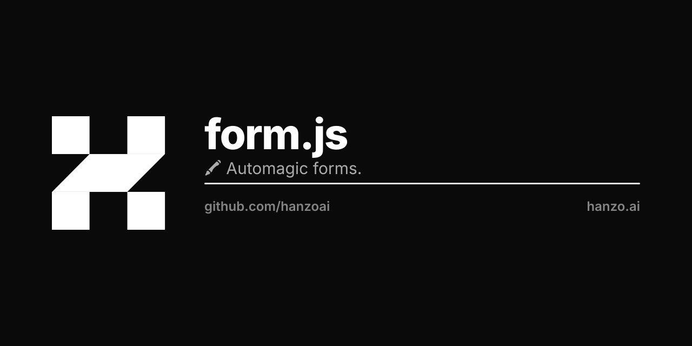

# Form.js

[![npm][npm-img]][npm-url]
[![build][build-img]][build-url]
[![dependencies][dependencies-img]][dependencies-url]
[![downloads][downloads-img]][downloads-url]
[![license][license-img]][license-url]
[![chat][chat-img]][chat-url]

> Automagic form validation and submission.

## Install

    npm install form.js

Or drop it inside a `<form>` and let it wire itself to the surrounding fields:

    <form>
      
      <input name="email">
      <button type="submit">Sign up</button>
    </form>

## Submission

Without a key, form.js is a thin controller around the surrounding form: it
emits lifecycle events and hands control back to your page. Set a Hanzo
publishable key on the script tag and it POSTs the serialized form to the Hanzo
forms ingest instead:

    POST https://api.hanzo.ai/v1/forms
    Authorization: Bearer pk_live_…
    Content-Type: application/json

    { "email": "ada@example.com", "metadata": { "name": "Ada" } }

Script-tag options (all `data-*`):

| attribute       | purpose                                                |
| --------------- | ------------------------------------------------------ |
| `data-key`      | publishable key (`pk_live_…` / `pk_test_…`)            |
| `data-token`    | `@hanzo/iam` access token (takes precedence over key)  |
| `data-endpoint` | override the full submission URL                       |
| `data-host`     | override the API host (default `https://api.hanzo.ai`) |

## Events

`window.Inform` is an event emitter — listen with `Inform.on` / `Inform.once`:

| event                 | `Inform.Events` | arguments                                               |
| --------------------- | --------------- | ------------------------------------------------------- |
| `init-inform-script`  | `InitScript`    | the `<script>` element                                  |
| `init-inform-form`    | `InitForm`      | the `<form>` element                                    |
| `init-inform-inputs`  | `InitInputs`    | array of input/select nodes                             |
| `init-inform-submits` | `InitSubmits`   | array of submit buttons                                 |
| `inform-submit`       | `OnSubmit`      | unmanaged: `(done, event)`; managed: `(payload, event)` |
| `inform-done`         | `OnDone`        | the submit event, or the API response (managed)         |
| `inform-error`        | `OnError`       | submission error (managed)                              |

In unmanaged mode, call `done()` from your `OnSubmit` listener to let the native
form submit proceed.

## License
[BSD][license-url]

[examples]:       https://github.com/hanzo-io/form.js/blob/master/test/test.coffee

[build-img]:        https://img.shields.io/travis/hanzo-io/form.js.svg
[build-url]:        https://travis-ci.org/hanzo-io/form.js
[chat-img]:         https://badges.gitter.im/join-chat.svg
[chat-url]:         https://gitter.im/hanzo-io/chat
[coverage-img]:     https://coveralls.io/repos/hanzo-io/form.js/badge.svg?branch=master&service=github
[coverage-url]:     https://coveralls.io/github/hanzo-io/form.js?branch=master
[dependencies-img]: https://david-dm.org/hanzo-io/form.js.svg
[dependencies-url]: https://david-dm.org/hanzo-io/form.js
[downloads-img]:    https://img.shields.io/npm/dm/form.js.svg
[downloads-url]:    http://badge.fury.io/js/form.js
[license-img]:      https://img.shields.io/npm/l/form.js.svg
[license-url]:      https://github.com/hanzo-io/form.js/blob/master/LICENSE
[npm-img]:          https://img.shields.io/npm/v/form.js.svg
[npm-url]:          https://www.npmjs.com/package/form.js
